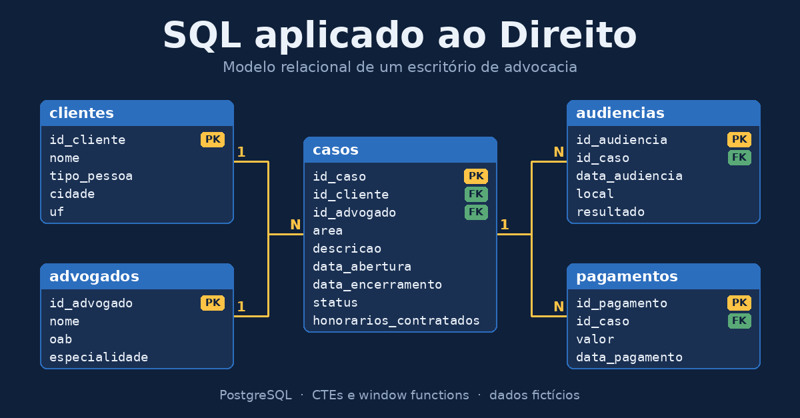

# SQL aplicado ao Direito: análise de um escritório de advocacia

Projeto de SQL (PostgreSQL) que modela a operação de um escritório de advocacia e responde a perguntas de gestão: carteira de casos, receita, honorários a receber, desempenho em audiências e prazos.

> **Dados 100% fictícios.** Nomes, valores e casos foram gerados por script para fins de estudo. Qualquer semelhança com pessoas ou escritórios reais é coincidência.

**Autora:** Patrícia Falchi · **Testado em:** PostgreSQL 16

---

## Perguntas que o projeto responde

| # | Pergunta de negócio | Técnicas |
|---|---|---|
| 1 | Quantos casos cada advogado tem e quantos estão em andamento? | `LEFT JOIN`, `COUNT ... FILTER` |
| 2 | Quais clientes mais pagaram? | `JOIN`, `SUM`, `RANK()` |
| 3 | Quais audiências pendentes ocorrem nos próximos 60 dias? | CTE, `CROSS JOIN`, aritmética de datas |
| 4 | Qual o ticket médio por caso e quantos pagamentos cada caso tem, em média? | CTE, `AVG` |
| 5 | Quantos casos cada advogado abriu por mês? | `DATE_TRUNC` |
| 6 | Qual a taxa de êxito de cada advogado nas audiências já realizadas? | `FILTER`, percentual |
| 7 | Onde há honorários a receber (contratado × recebido)? | CTE, `LEFT JOIN`, `COALESCE` |
| 8 | Como evolui a receita mês a mês (variação e acumulado)? | `generate_series`, `LAG`, `SUM() OVER`, `NULLIF` |
| 9 | Quanto tempo leva da abertura do caso até a 1ª audiência, por área? | CTE, `MIN` |
| 10 | Em cada área, qual advogado gerou mais receita? | `RANK() OVER (PARTITION BY ...)` |

## Modelo de dados



- **5 tabelas** ligadas por chaves estrangeiras: `clientes` e `advogados` se relacionam com `casos`; `audiencias` e `pagamentos` pertencem a um caso.
- **Integridade no próprio banco:** `NOT NULL`, `UNIQUE` (OAB), `CHECK` em status, resultado e valores, e regra de que um caso encerrado tem data de encerramento (e só ele).
- **Índices** nas chaves estrangeiras usadas nos `JOIN`s.
- **LGPD / minimização de dados:** o modelo não guarda CPF nem outros dados pessoais sensíveis; para a análise basta o identificador interno do cliente.

## Estrutura dos arquivos

| Arquivo | O que faz |
|---|---|
| `schema_juridico.sql` | Cria as tabelas, restrições e índices |
| `data_juridico.sql` | Insere os dados fictícios (14 clientes, 6 advogados, 40 casos, 58 audiências, 77 pagamentos) |
| `gerar_dados.py` | Script que gera o `data_juridico.sql` (seed fixa: sempre os mesmos dados) |
| `queries.sql` | As 10 consultas de análise, comentadas |
| `verificacoes.sql` | Checagens de qualidade dos dados (todas devem retornar 0 linhas) |
| `docs/der.png` | Diagrama do modelo |

## Como executar

Com `psql`:

```bash
createdb juridico
psql -d juridico -f schema_juridico.sql
psql -d juridico -f data_juridico.sql
psql -d juridico -f verificacoes.sql   # deve retornar 0 linhas em cada checagem
psql -d juridico -f queries.sql
```

No **pgAdmin**: crie um banco `juridico`, abra o *Query Tool* e execute, nessa ordem, `schema_juridico.sql`, `data_juridico.sql` e depois cada consulta de `queries.sql`.

> **Data de referência:** as consultas usam `2025-12-31` como "hoje" (em vez de `CURRENT_DATE`) para que os resultados sejam reproduzíveis.

Para regenerar os dados: `python gerar_dados.py > data_juridico.sql`.

## Exemplos de resultado

**1) Carteira por advogado**

| advogado | total_casos | em_andamento |
|---|---|---|
| Dra. Camila Torres | 9 | 8 |
| Dr. André Matos | 8 | 7 |
| Dra. Luana Reis | 8 | 6 |
| Dr. Pedro Rocha | 6 | 5 |
| Dr. Felipe Lima | 5 | 5 |
| Dra. Helena Braga | 4 | 4 |

**6) Taxa de êxito nas audiências realizadas** (êxito = resultado *Favorável* ou *Acordo*)

| advogado | audiencias_realizadas | exitos | taxa_exito_pct |
|---|---|---|---|
| Dra. Helena Braga | 10 | 8 | 80.0 |
| Dr. Felipe Lima | 5 | 4 | 80.0 |
| Dra. Luana Reis | 14 | 9 | 64.3 |
| Dra. Camila Torres | 10 | 6 | 60.0 |
| Dr. André Matos | 7 | 4 | 57.1 |
| Dr. Pedro Rocha | 8 | 4 | 50.0 |

**3) Audiências pendentes nos próximos 60 dias**

| data_audiencia | dias_ate_audiencia | id_caso | advogado | local |
|---|---|---|---|---|
| 2026-01-08 | 8 | 28 | Dr. Felipe Lima | Vara do Trabalho de Curitiba |
| 2026-01-14 | 14 | 33 | Dr. André Matos | Fórum de Curitiba |
| 2026-01-28 | 28 | 35 | Dr. André Matos | Fórum de Belo Horizonte |
| 2026-02-09 | 40 | 4 | Dra. Luana Reis | Fórum de Campinas |

## Decisões e cuidados de análise

- **Agrupar por ID, não por nome:** nomes podem se repetir; o `GROUP BY` usa a chave e exibe o nome.
- **Duas métricas, dois nomes:** na consulta 4, *ticket médio* (R$) e *média de pagamentos* (quantidade) são colunas separadas, para não haver ambiguidade.
- **Meses sem receita contam:** na consulta 8, um calendário gerado com `generate_series` evita comparar um mês com o "mês anterior errado" quando não houve pagamento.
- **Definição explícita de êxito:** a taxa de êxito está documentada na própria consulta, e audiências pendentes ficam de fora do cálculo.
- **Agregar antes de juntar:** nas consultas 4 e 7, os pagamentos são somados em uma CTE antes do `JOIN`, para não duplicar linhas.

## Limitações e próximos passos

- Base pequena e sintética: serve para demonstrar modelagem e consultas, não para tirar conclusões reais.
- Próximo passo: dashboard em Power BI sobre este modelo, com medidas DAX (receita, ticket médio, taxa de êxito, saldo a receber).
